<p align="center"></p>

# Sequential Countdown (MetaTrader 5 and MetaTrader 4)

A free indicator that numbers the **9-13 sequential count** on the chart: setup 1 to 9 (perfected 9s marked) and countdown
1 to 13, **on closed bars only**, with alerts on every 9 and 13. The count has several published variants, so the exact
one is stated in full. Source for both editions, a Python reference of the rules, and the tests that were used to check
that the MT5 and MT4 code, the Python reference and each other all agree.

**Website:** [allanninal.dev/mql5 (indicators)](https://www.allanninal.dev/mql5/#indicators) · [MT4 editions](https://www.allanninal.dev/mql5/#mt4) · [allanninal.dev](https://www.allanninal.dev)
· **Contact:** message me on [LinkedIn](https://www.linkedin.com/in/allanninal/).

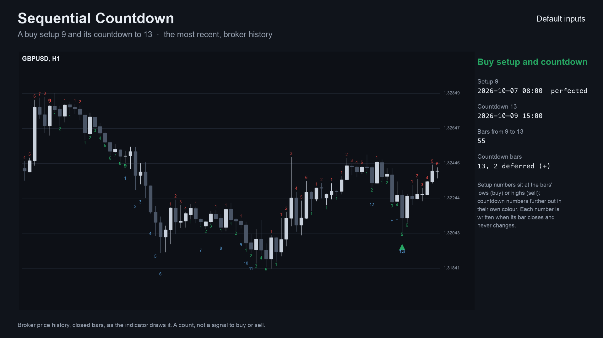

> It is an indicator, not a strategy. It numbers bars and places no trades. A 9 or a 13 is a count, not a signal to buy or
> sell. Nothing here is a profit claim (see [Honest limits](#honest-limits)).

## Get it on the MQL5 Market

| Edition | Platform | Price | Link |
|---|---|---|---|
| Sequential Countdown | MT5 | free | <https://www.mql5.com/en/market/product/201875> |
| Sequential Countdown MT4 | MT4 | free | <https://www.mql5.com/en/market/product/202363> |
| Sequential Scanner | MT5 | paid | <https://www.mql5.com/en/market/product/201877> |
| Sequential Scanner MT4 | MT4 | paid | <https://www.mql5.com/en/market/product/202422> |

The Market builds are the same calculation as the source in this repository. The two scanner editions are a separate,
paid product that is **not** part of this repository (see [Free vs Pro](#free-vs-pro)).

## Contents

1. [What it is and who it is for](#what-it-is-and-who-it-is-for)
2. [Why it was built](#why-it-was-built)
3. [How it works](#how-it-works)
4. [Non-repainting: the proof and how it was tested](#non-repainting-the-proof-and-how-it-was-tested)
5. [Architecture and buffers](#architecture-and-buffers)
6. [Inputs, alerts, install and compile](#inputs-alerts-install-and-compile)
7. [Run the Python reference and the tests](#run-the-python-reference-and-the-tests)
8. [Honest limits](#honest-limits)
9. [Free vs Pro](#free-vs-pro)
10. [Licence](#licence)

## What it is and who it is for

**What:** the 9-13 count in one stated variant. A *setup* counts 1 to 9 bars that each close beyond the close four bars
earlier. A completed setup starts a *countdown* from 1 to 13. The indicator writes the setup numbers under (buy) or above
(sell) the bars with the 9 in bold, marks a **perfected** 9, writes the countdown numbers further out in their own colours,
and draws an arrow at a 13. Alerts: pop-up (on by default), sound, push notification, e-mail, on a completed 9 and a 13.

**For:** traders who already use the 9-13 count and want it counted by fixed, readable rules. Also for developers who want
a small, tested counter with documented buffers to read from an EA with `iCustom`.

**Not for:** anyone who expects a 9 or a 13 to call a turn. The count marks where a run of closes completed.

| | |
|---|---|
| 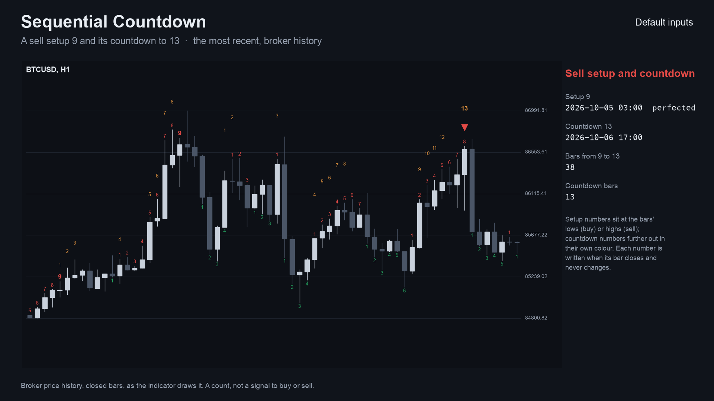 | 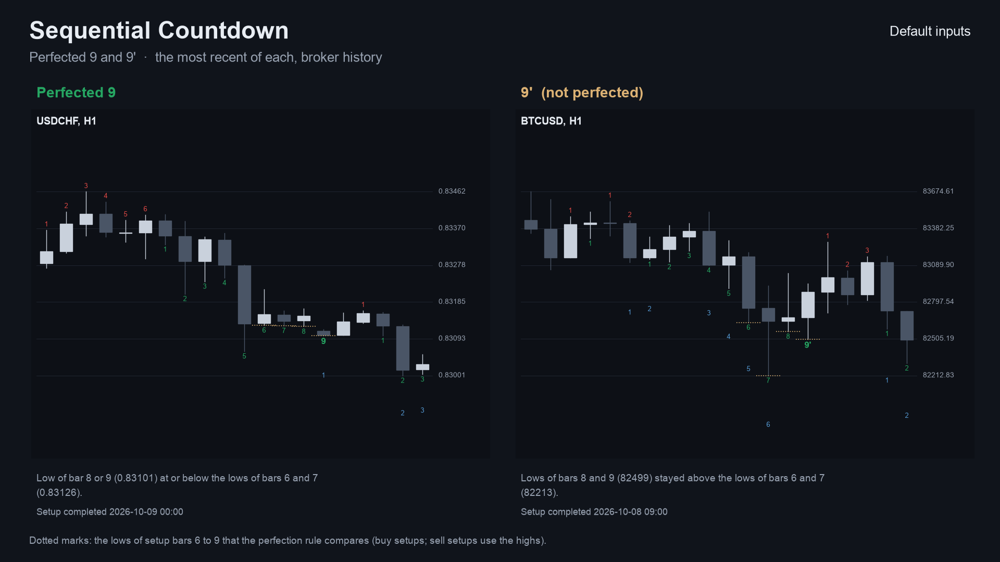 |
| 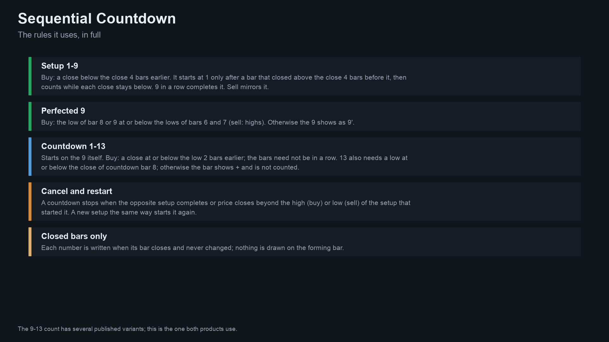 | 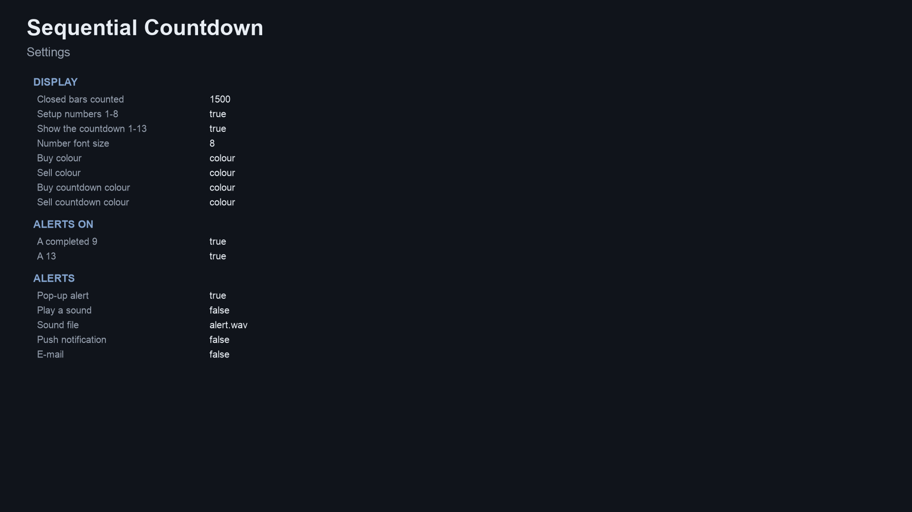 |

Image notes: the charts are drawn by the Python reference on broker price history (the same numbers the indicator shows);
the rules and settings sheets are illustrations, not terminal captures. MT4 versions are in
[`docs/images/mt4/`](docs/images/mt4).

## Why it was built

The 9-13 count is a long-standing method, but implementations disagree on the details (how a countdown is cancelled or
restarted, how the 13 qualifies), so the same chart gets different numbers in different tools. The motivations, stated with
the evidence we actually have:

- **One stated variant.** [`docs/SPEC.md`](docs/SPEC.md) and the tables below say exactly which rules are used, and
  [`tests/reference.py`](tests/reference.py) is the rule book.
- **Trust in the numbers.** A number is written when its bar closes and never changes afterwards. Our market research
  (October 2026) found repeated complaints about indicators that repaint.
- **Honest scale of demand.** The same research found a small niche: about 16 indicators for this count on the MQL5 Market
  (one of them free), and only about 19 freelance-job mentions. This is a free tool with a clean, tested reference
  implementation, not a claim of mass demand.
- **Provable behaviour.** Every number in this README comes from an executed check, listed below.

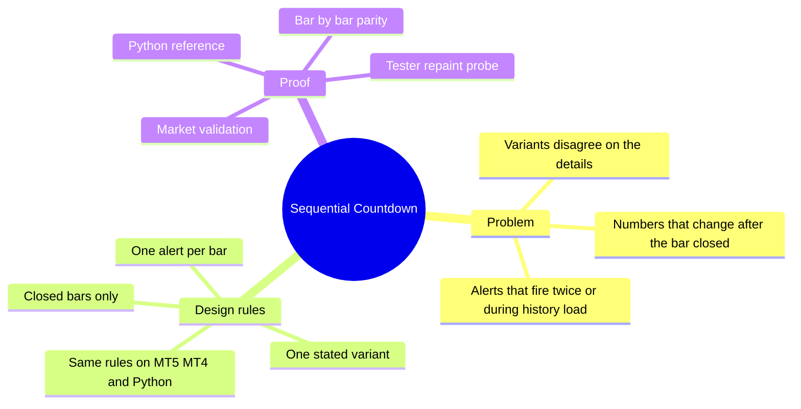

## How it works

### The variant, step by step

`k` is the bar that just closed; `C`, `H`, `L` are close, high, low, with `C[k-4]` the close four bars earlier.

**Buy setup**

1. A bar counts when `C[k] < C[k-4]`.
2. The count starts at **1** only after a *flip*: the previous bar closed above its own four-bars-earlier close
   (`C[k-1] > C[k-5]`). While the condition holds, the following bars count 2, 3 ...; any other bar resets the count to 0.
3. At **9** the setup is complete and the count resets (a new setup needs a new flip).
4. It is **perfected** if the low of bar 8 or bar 9 is at or below the lows of bars 6 and 7. A 9 that is not perfected is
   shown as `9'`.
5. The setup's **resistance** is the highest high of its nine bars.

**Buy countdown**

1. A completed buy setup starts (or restarts, "recycle") a buy countdown, counting from setup bar 9 itself.
2. A countdown bar is a bar with `C[k] <= L[k-2]`. The bars need not be consecutive.
3. The 13th countdown bar must also have `L[k] <=` the close of countdown bar 8; a bar that meets the close rule but not this
   one is *deferred* (shown as `+`, not counted). 13 completes the countdown and ends it.
4. The countdown is **cancelled** by a completed sell setup, or by a close above the resistance of the setup that started it.

**Sell setup and countdown** mirror all of it (`C[k] > C[k-4]`, flip `<`, perfected on highs, countdown `C[k] >= H[k-2]`,
13 needs `H[k] >=` the close of bar 8, cancelled by a buy setup or a close below the setup's support). A completed setup
cancels the opposite countdown.

### Per-bar algorithm

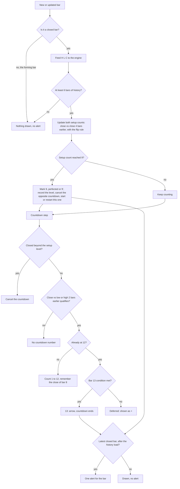

### Count states (buy side; the sell side mirrors it)

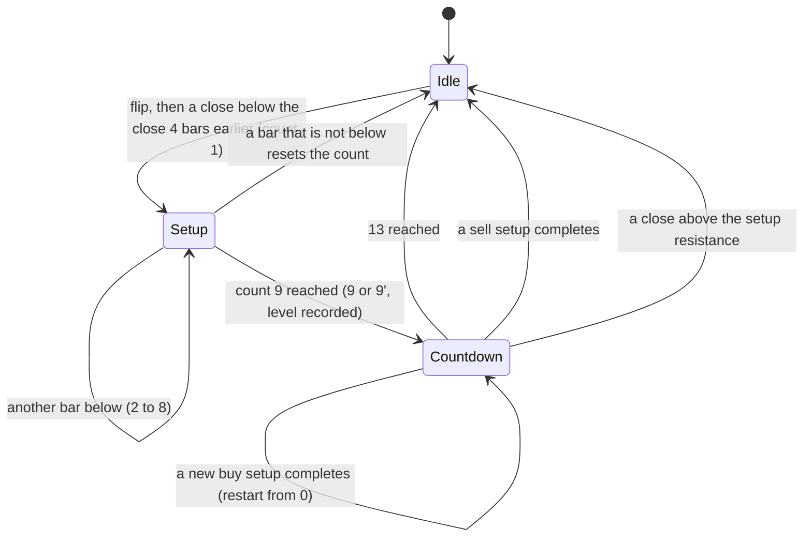

### Alert flow

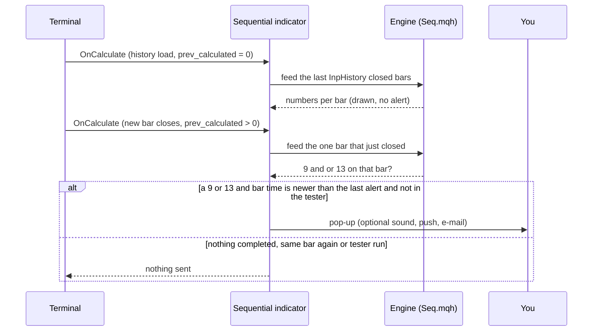

### How often it counts (measured)

Counts per 1,000 closed bars, default rules, on broker history of EURUSD, GBPJPY, XAUUSD and BTCUSD (H1: 374,992 bars, up
to 100,000 per symbol; H4: 103,893; M15: 25,768 because the M15 history in the tester was shorter). It counts bars only,
not what price does afterwards. Source: [`docs/data/count-frequency.json`](docs/data/count-frequency.json), made by
[`tests/frequency.py`](tests/frequency.py).

```mermaid
xychart-beta
    title "Completed setups (9) and countdown 13s per 1,000 closed bars"
    x-axis ["M15", "H1", "H4"]
    y-axis "per 1,000 bars" 0 --> 30
    bar [25.26, 23.9, 26.36]
    bar [6.75, 6.15, 6.57]
```

First series: completed 9s (buy plus sell). Second series: completed 13s. About one 9 per 40 bars, and roughly one 9 in four
goes on to a 13 (the rest are cancelled by an opposite setup or a close beyond the setup level, or are restarted). Of the
9s, about 73 to 78% are perfected at these defaults. The counts per bar are close on all three timeframes.

## Non-repainting: the proof and how it was tested

"Non-repainting" is easy to claim. Here is what was actually run. Raw result files are in [`tests/results/`](tests/results).

**1. Implementations compared bar by bar.** The Python reference ([`tests/reference.py`](tests/reference.py)) holds the rules of the stated variant. The MT5 and MT4 indicators were dumped bar by bar (every buffer) in the MetaTrader Strategy Tester (MT4) or by a script (MT5), and [`tests/check_parity.py`](tests/check_parity.py) compared each dump with the reference: setup and countdown numbers must be identical on every closed bar.

Run on this exact code: compile 0 errors, 0 warnings (both editions); MT5 24 dumps and MT4 25 dumps (EURUSD, GBPJPY, XAUUSD, BTCUSD on M15, H1 and H4 with the repository's input sets; MT4 adds an every-tick run on EURUSD H1), all identical to the reference on every closed bar; the repaint probes found 0 closed bars that changed afterwards.

**The wider matrix**, made with the Market builds before this repository was cut from them (the same calculation; four symbols EURUSD, GBPJPY, XAUUSD, BTCUSD, M15, H1 and H4, the repository's input sets), checked here against the same reference:

| | MT5 | MT4 |
|---|---|---|
| dumps compared | 24 | 25 |
| bars compared | 1,009,330 | 509,573 |
| failures | 0 | 0 |
| result | ALL PASS | ALL PASS |

Sources: [`tests/results/parity-wide-run-mt5.txt`](tests/results/parity-wide-run-mt5.txt), [`tests/results/parity-wide-run-mt4.txt`](tests/results/parity-wide-run-mt4.txt). MT5 history starts later than MT4's test history on some pairs, which is why the bar counts differ.

**2. Repaint probe.** An EA records which signal buffers are set on each bar *at the moment it closes*, then reads the same bars again at the end and counts any value that changed. It also counts any signal ever shown on the still-forming bar.

| Run | Closed bars checked | Signals seen at close | Changed afterwards | Signals on the live bar |
|---|---|---|---|---|
| MT5, Market build, EURUSD H1, every tick, 10,411,052 ticks | 4,644 | 5,145 | **0** | **0** |
| MT4, Market build, 25 runs combined | 506,172 | 3,218 | **0** | **0** |

Source: [`tests/results/repaint-summary.md`](tests/results/repaint-summary.md). The MT5 probe was run once per build on one symbol and timeframe; the MT4 probe ran on every dump run.

**3. Market validation.** Both Market builds passed the MQL5 Market's automated product validation before publication (this is the Market's own check, not part of this repository).

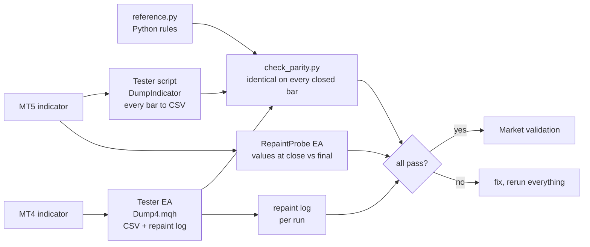


### Why the design cannot repaint

- The engine is fed only bars up to `rates_total - 2`, i.e. never the forming bar, so a number is written only after its bar
  has closed.
- Each decision uses that bar and earlier bars only (closes four bars earlier, lows or highs two bars earlier, the
  recorded setup bars). There is no look-ahead.
- Alerts fire only for the bar that just closed, only after the history load, once per bar, and never in the tester.
- What *does* depend on history length: the count is made from the first bar the indicator loads (`InpHistory`), so a
  count that was already running before that bar can start differently on a shorter history. Numbers on the loaded bars do
  not change as new bars arrive.

## Architecture and buffers

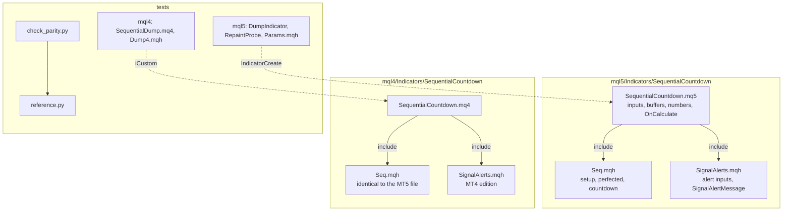

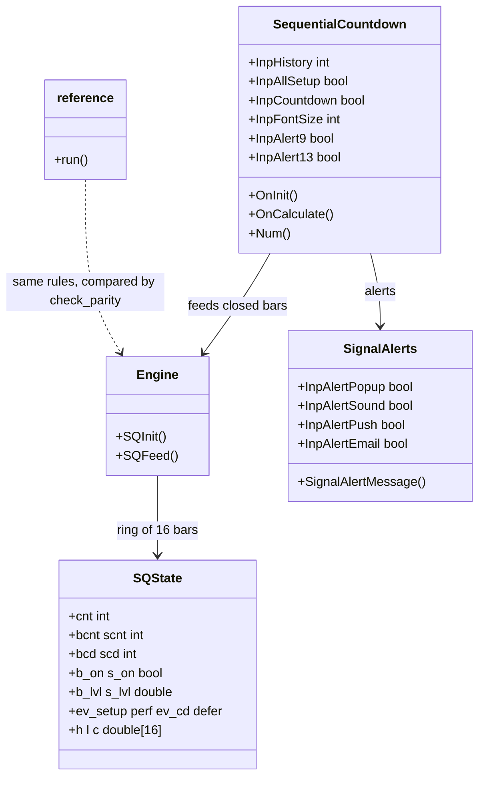

### `iCustom` buffer table (for EA developers)

| Buffer | MT5 | MT4 |
|---|---|---|
| 0 | **Buy 13** arrow price (bar low on MT5, below it on MT4), empty otherwise | same |
| 1 | **Sell 13** arrow price (bar high on MT5, above it on MT4), empty otherwise | same |
| 2 | buy setup count of the bar (1-8; 9 = complete; 10 = perfected 9) | same |
| 3 | sell setup count of the bar (same coding) | same |
| 4 | buy countdown number of the bar (1-13; -1 = deferred); empty otherwise | same |
| 5 | sell countdown number of the bar (same coding) | same |

Empty value is `EMPTY_VALUE`. Read values on **closed bars** (shift 1 and higher). `iCustom` parameters follow the input
order: history, show setup 1-8, show countdown, font size, buy, sell, buy countdown and sell countdown colours, (MT4 only: 13
arrow gap), alert on 9, alert on 13, pop-up, sound, sound file, push, e-mail. In MT5 the `input group` headings also count as
string parameters when you build a handle with `IndicatorCreate` (see `tests/mql5/Include/IndTest/Params.mqh` and the strings
in `tests/check_parity.py`).

## Inputs, alerts, install and compile

| Input | Default | Meaning |
|---|---|---|
| Closed bars to count on the chart | 1500 (100-20000) | How far back the count starts |
| Show setup numbers 1-8 | true | Off: only the 9s are written |
| Show the countdown 1-13 | true | Countdown numbers in their own colours |
| Number font size | 8 | 6-16 |
| Buy, Sell, Buy countdown, Sell countdown colours | green, red, blue, orange | Look only |
| Alerts on a completed 9 / a 13 | true / true | Which events alert |
| 13 arrow distance from the candle (MT4 only) | 1.8 x ATR(14) | MT4 cannot shift arrows by pixels |
| Pop-up alert | true | Terminal alert window |
| Play a sound / sound file | false / alert.wav | File from the terminal's Sounds folder |
| Push notification | false | Needs your MetaQuotes ID in Options |
| E-mail | false | Needs e-mail set up in Options |

**Install from source.** Copy `mql5/Indicators/SequentialCountdown/` into `<terminal data folder>/MQL5/Indicators/` (MT5) or
`mql4/Indicators/SequentialCountdown/` into `<data folder>/MQL4/Indicators/` (MT4), open the `.mq5` or `.mq4` in MetaEditor
and press Compile (F7). Both compile with 0 errors and 0 warnings (checked on a Windows machine with MetaEditor, from a clean scratch folder that holds only these files; the compiled files are not in the
repository). Keep the three files of each edition together: the indicator includes `Seq.mqh` and `SignalAlerts.mqh` from
its own folder.

## Run the Python reference and the tests

```bash
python3 -m venv .venv && . .venv/bin/activate && pip install -r requirements.txt
```

```python
import sys; sys.path.insert(0, "tests")
from reference import run
# high, low, close are float lists of closed bars, oldest first
rows = run(high, low, close)    # rows[k]: ev_setup (+1 buy 9, -1 sell 9), perf, ev_cd (13), bmark, smark, defer, ...
```

To repeat the parity check on your own data:

1. Compile the indicator and the test tool for your platform (`tests/mql5/Scripts/DumpIndicator`, or
   `tests/mql4/SequentialDump.mq4` with `tests/mql4/Include/IndTest4/Dump4.mqh` in your `MQL4/Include/IndTest4/`; MT5 also
   needs `tests/mql5/Include/IndTest/Params.mqh`).
2. Run it in the Strategy Tester (MT4) or as a script (MT5) for each symbol and timeframe, with the input sets in
   `tests/configs.tsv` (MT5; the exact `InpParams` strings are in `tests/check_parity.py`) and `tests/mql4/configs.tsv`
   (MT4). The tool writes one CSV per symbol and timeframe into a `dump` folder.
3. `python3 tests/check_parity.py <folder that contains dump>` (add `--mt4` for MT4 dumps). It prints PASS or FAIL per
   file and an overall result.
4. Repaint: run `tests/mql5/Experts/RepaintProbe` in the MT5 Strategy Tester (every tick); the MT4 test EA writes its
   repaint log with the dump.

The price dumps used for the published numbers are not in this repository (they are broker price data).

## Honest limits

- **A count is not a strategy.** No stop-loss, position sizing or exit rules are provided or implied, and the rules were
  not optimised or back-tested for profit. A 9 or a 13 says a run of closes completed, nothing about what comes next.
- **No profit or accuracy claim is made.** The only numbers here are about *consistency* (the implementations agree,
  numbers do not move) and *frequency* (counts per 1,000 bars).
- **One variant of several.** Other tools cancel, restart or qualify the count differently, so their numbers will differ
  from these on the same chart. The variant here is stated above and tested exactly.
- **The count depends on where it starts.** A countdown that was already running before the first loaded bar is not seen,
  so the first numbers of a short history can differ from those of a longer one.
- **Frequent 9s.** About one 9 per 40 bars; most are not followed by a 13.
- **Scope of the tests.** Four symbols on M15, H1 and H4 for the Market builds (the same calculation), the repository's input sets, one MT5 repaint run; the code in this repository has so far been compile-checked only, and the MT5 build was not run on a live chart as part of these numbers. Other symbols and timeframes are not covered by the published numbers.
- A multi-symbol scanner that watches the count across many symbols exists as a separate paid product (see below).

## Free vs Pro

| | Free: Sequential Countdown | Paid: Sequential Scanner |
|---|---|---|
| Platforms | MT5 [201875](https://www.mql5.com/en/market/product/201875), MT4 [202363](https://www.mql5.com/en/market/product/202363) | MT5 [201877](https://www.mql5.com/en/market/product/201877), MT4 [202422](https://www.mql5.com/en/market/product/202422) |
| Price | free | paid (see the Market page) |
| What you get | The full count on the current chart (setup, countdown, perfected 9, arrows), alerts on 9 and 13, source here | A multi-symbol, multi-timeframe scanner, as described on its Market listing |
| Source | this repository | not published |
| Closed-bar numbers, no repaint | yes | see its listing |

No need to buy the paid product to use the free one: the free indicator is complete on its own.
Website: [allanninal.dev/mql5](https://www.allanninal.dev/mql5/#indicators) ([MT4](https://www.allanninal.dev/mql5/#mt4)).

## Licence

Copyright 2026 Allan Niñal (<https://www.allanninal.dev/mql5>). Licensed under the
[PolyForm Noncommercial License 1.0.0](LICENSES/PolyForm-Noncommercial-1.0.0.md): source-available, free for personal
and other noncommercial use, not for commercial use. Each source file has an `SPDX-License-Identifier` line. Text:
[`LICENSE`](LICENSE). The 9-13 count is a publicly described method; the code is original, written from the stated variant
and not a port of any other program. The licence applies to this source, not to anything you build or trade with the
indicator. Trading involves risk; the software is provided as is.

---

**Website:** [allanninal.dev/mql5](https://www.allanninal.dev/mql5/#indicators) · [MT4](https://www.allanninal.dev/mql5/#mt4) · [allanninal.dev](https://www.allanninal.dev)
· Questions: message me on [LinkedIn](https://www.linkedin.com/in/allanninal/).
